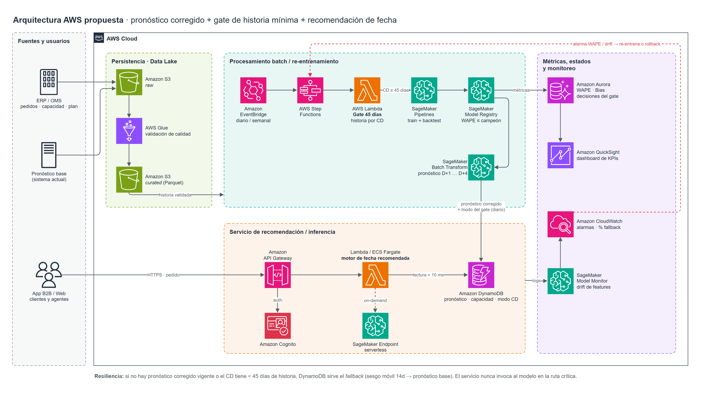
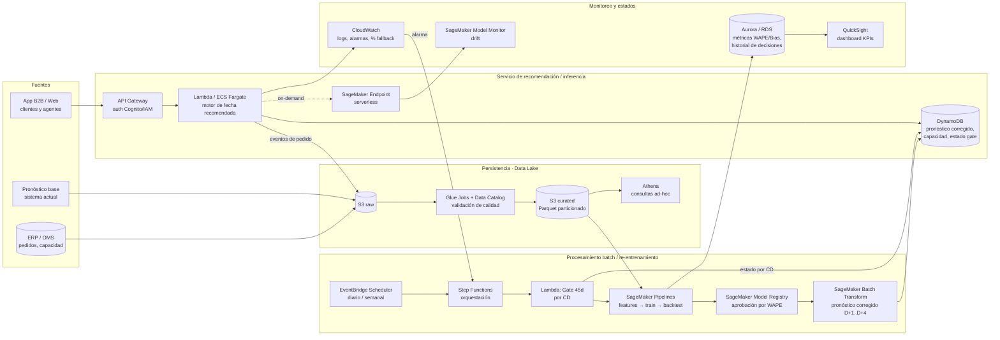

# Arquitectura AWS (Tarea 5)

Fuente editable: [`arquitectura_aws.drawio`](arquitectura_aws.drawio) (draw.io / diagrams.net, íconos oficiales AWS). También en [`arquitectura_aws.svg`](arquitectura_aws.svg).

## Diagrama (Mermaid)

| Componente | Rol | Interacciones / razonamiento |
|---|---|---|
| **S3 raw / curated + Glue + Athena** | *Persistencia*: data lake con histórico de pedidos, pronósticos, capacidad y plan | Glue valida esquema y calidad (nulos, huecos, negativos) antes de que lleguen al modelo; Parquet particionado por fecha/CD |
| **EventBridge + Step Functions** | *Batch*: orquesta el pipeline diario (inferencia) y semanal (re-entrenamiento) | Reintentos y ramas de error explícitas; si algo falla, se mantiene el último pronóstico válido |
| **Lambda Gate 45d** | Evalúa historia continua por CD y publica el modo (MODEL/FALLBACK) | Su salida decide qué CDs entran al entrenamiento y qué fuente se sirve; queda trazada en DynamoDB y RDS |
| **SageMaker Pipelines + Model Registry** | Feature engineering, entrenamiento, backtest rolling-origin y registro | Solo se promueve un modelo si su WAPE de backtest ≤ el campeón y ≤ fallback (*quality gate* automático) |
| **SageMaker Batch Transform** | Genera el pronóstico corregido D+1..D+4 de todos los CDs cada día | Batch porque el pronóstico es diario y por CD: más barato y simple que inferencia online |
| **DynamoDB** | Estado *caliente*: pronóstico corregido, capacidad por slot y estado del gate | Lectura de ms para el servicio de recomendación |
| **API Gateway + Lambda/Fargate** | *Servicio de recomendación*: al crear un pedido, devuelve las fechas sugeridas con utilización proyectada e incentivo | Lee DynamoDB (no llama al modelo en la ruta crítica → baja latencia y sin dependencia del endpoint). El endpoint serverless queda para re-cálculos on-demand |
| **Aurora/RDS + CloudWatch + Model Monitor + QuickSight** | *Persistencia de métricas y estados*: WAPE/Bias por CD/horizonte, % fallback, decisiones del gate, drift | Alarmas (p.ej., WAPE semanal > umbral o % fallback ↑) disparan re-entrenamiento o rollback |

**Resiliencia end-to-end:** el servicio nunca depende de que el modelo esté disponible: si no hay pronóstico corregido vigente se sirve el fallback (sesgo móvil o base) desde DynamoDB.
